<div align="center">

# Global Mart Lakehouse

**An open-source data lakehouse foundation on Kubernetes: MinIO object storage, MySQL, and a standalone Hive Metastore, all defined as code.**


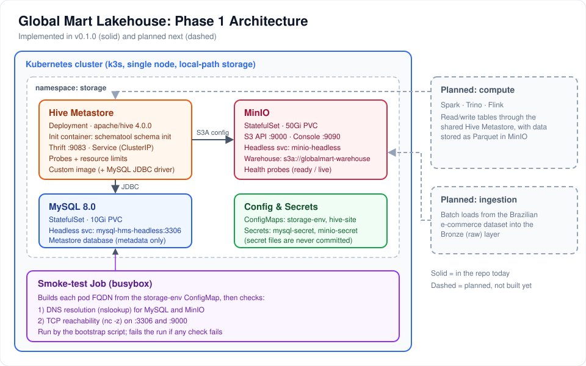

</div>

---

## Project Status

| Area | Status |
|---|---|
| **Phase 1: Infrastructure foundation** (this repo, `v0.1.0`) | ✅ Delivered |
| Persistence validation and object storage usage (Phase 2) | 🔜 Next |
| Source database: Brazilian e-commerce on SQL Server, deployed on Kubernetes | 🔄 In progress (manifests, bootstrap and smoke test written) |
| MSSQL → MinIO Parquet export (Bronze layer) | 🔄 Drafted, not yet working end to end |
| Silver and Gold layers | 📋 Planned |
| Compute engines (Spark / Trino / Flink) | 📋 Planned |
| Apache Iceberg table format | 📋 Planned |
| Helm packaging of the platform | 📋 Planned |

> **Honest scope note:** the **platform layer** (Phase 1) is complete. No data has been successfully ingested into the lake yet and no compute engine is deployed. A SQL Server source database and an MSSQL → MinIO export pipeline are in progress (see below). The business discovery work (stakeholders, BEAM\* events, conceptual model) is done and is summarised below, and it drives what gets built next.

## Why This Project Exists

**Global Mart** is a fictional retail company selling bags, shoes, and accessories in Brazil and Bangladesh. Its CEO wants to know whether the business is heading in the right direction, which requires bringing sales, inventory, customer, marketing, finance, and shipping data into one analytics-ready platform, without depending on a cloud vendor.

This repository builds that platform from the ground up, **foundation first**: reliable storage, a metadata catalog, and automation, before any data or compute is added.

## What Is Built Today

| Component | Kubernetes object | Details |
|---|---|---|
| **MinIO** | StatefulSet + headless Service | S3-compatible object storage, 50Gi PVC, API `:9000`, console `:9090`, readiness/liveness probes |
| **MySQL 8.0** | StatefulSet + headless Service | Metastore backend, 10Gi PVC, `fsGroup` set for volume permissions, probes, CPU/memory requests and limits |
| **Hive Metastore 4.0.0** | Deployment + ClusterIP Service | Metastore-only (no HiveServer2, HDFS, or YARN), Thrift on `:9083`, schema created by an init container |
| **Custom Hive image** | `docker/hive-metastore/Dockerfile` | Extends `apache/hive:4.0.0` with the MySQL JDBC driver (8.3.0) and `envsubst` |
| **Configuration** | ConfigMaps | `storage-env` (shared names and ports) and `hive-site-config` (templated `hive-site.xml`) |
| **Secrets** | Kubernetes Secrets | MySQL and MinIO credentials, kept out of Git |
| **SQL Server source** (in progress) | StatefulSet + headless Service | SQL Server 2022 (Developer edition) in the `datasets` namespace, 2Gi PVC, 2 CPU / 2Gi memory, SA password from a Secret |
| **Smoke test** | Job | Verifies DNS and TCP reachability of MySQL and MinIO |
| **Automation** | Bash scripts | Idempotent bootstrap with readiness waits and smoke test, plus a teardown script |

## Engineering Highlights

- **Right workload type for the job:** stateful services (MinIO, MySQL) run as **StatefulSets** with **headless Services** for stable DNS identities. Hive Metastore, which is stateless, is a Deployment.
- **Durable by design:** data lives on PersistentVolumeClaims (`local-path` storage class), so it outlives pod restarts.
- **Credentials stay out of config and Git:** the Hive config is a **template** (`hive-site.xml.template`). The init container injects the database username and password from a Secret using `envsubst`, so credentials are never stored in the ConfigMap. Secret manifests are excluded by `.gitignore`.
- **Metastore-only Hive:** Hive runs purely as a shared metadata service that Spark, Trino, or Flink can later reuse. Metadata lives in MySQL, and table data will live in MinIO, so each concern is decoupled.
- **Self-initialising schema:** an init container runs `schematool --initOrUpgradeSchema` before the metastore starts.
- **Health and resource management:** readiness and liveness probes on every service, and resource requests/limits on MySQL and Hive.
- **Config over hard-coding:** the smoke test builds service FQDNs from the `storage-env` ConfigMap instead of hard-coded names.
- **Safe, repeatable automation:** scripts use `set -euo pipefail` and `kubectl apply`, so re-running them is safe. The bootstrap script waits for pods to become ready, then runs the smoke test and prints the job logs on failure.

### Bootstrap flow

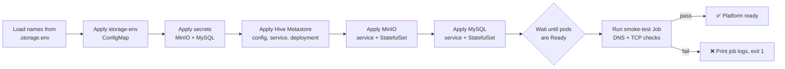

### Hive Metastore startup

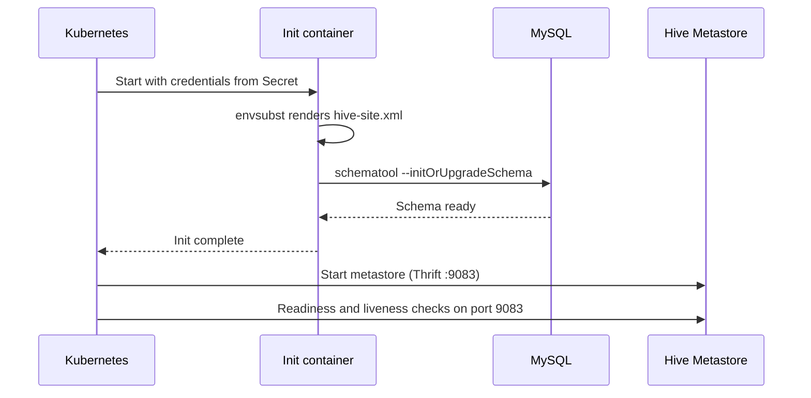

## In Progress: Source Database and Bronze Ingestion

The first source is the **Brazilian e-commerce** dataset, hosted in a SQL Server instance on the same cluster, from which tables are exported to MinIO as **Parquet** (the Bronze/raw layer).

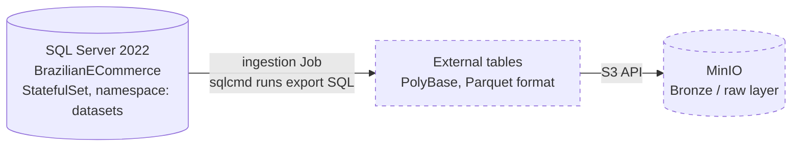

| Piece | State |
|---|---|
| SQL Server StatefulSet, Service, namespace, env ConfigMap | Written; `bootstrap-datasets.sh` applies them and runs a smoke test |
| Export SQL (create external data source, Parquet file format, one external table per source table) | Drafted in `datasets/scripts/SQL/` |
| Ingestion Job (`sqlcmd` runs the export SQL inside the cluster) | Drafted in `datasets/manifests/tools/` |
| Loading the dataset into SQL Server | Not yet automated or documented |
| End-to-end run (Parquet files visible in MinIO) | **Not yet validated** |

## Planned: Table Format and Packaging

These are design intentions, not implemented yet.

**Apache Iceberg (table format).** The planned file format is Parquet in MinIO (nothing is stored there yet). The plan is to add Iceberg on top, using the existing Hive Metastore as the catalog, so the Silver/Gold layers get ACID transactions, schema evolution, partitioning, and time travel. It was deliberately deferred from Sprint 1 so the foundation stayed minimal and verifiable first.

**Helm (deployment packaging).** Phase 1 uses plain YAML manifests applied by a bootstrap script. The next stage is to move the components into Helm charts, so installs become versioned, parameterised (image tags, storage sizes, credentials via values), and repeatable across environments, replacing the script-driven `kubectl apply` flow.

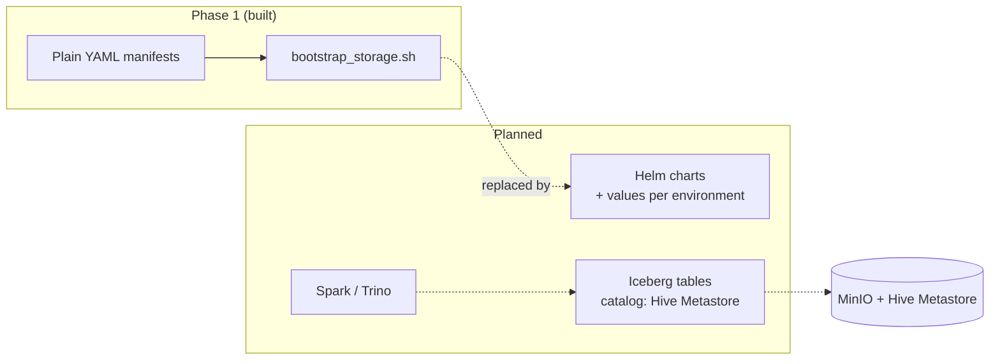

## Planned Data Model

Requirements were captured with **BEAM\*** (Business Event Analysis and Modeling) workshops in Sprint 0. Six business events were identified and designed to share **conformed dimensions**, which will form the Gold layer.

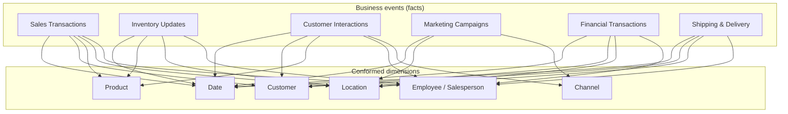

> The diagram is a simplified view of the Sprint 0 conceptual model, not an implemented schema.

| Event | Event type | Grain |
|---|---|---|
| Sales Transactions | Discrete | One row per product purchase per order |
| Inventory Updates | Recurring | One row per product adjustment per warehouse |
| Customer Interactions | Evolving | One row per customer interaction |
| Marketing Campaigns | Evolving | One row per campaign event |
| Financial Transactions | Discrete | One row per financial entry |
| Shipping & Delivery | Accumulating | One row per shipment event |

**Planned data sources:** Brazilian and Bangladesh e-commerce databases, CRM/product/store/POS CSV exports, and external datasets (Mexico import/export trade data, Retail Transactions, Global Superstore).

## Repository Structure

```text
global-mart-lakehouse/
├── datasets/                            # Source datasets (in progress)
│   ├── manifests/                       # SQL Server StatefulSet, Service, namespace, ingestion Job
│   └── scripts/                         # Bootstrap/teardown, export SQL, cert helper
├── docker/
│   └── hive-metastore/Dockerfile        # Hive 4.0.0 + MySQL JDBC driver
├── docs/
│   ├── images/                          # README visuals
│   └── phase-01-infrastructure/         # Design doc, phase README, release notes
└── infrastructure/
    ├── manifests/
    │   ├── base/                        # Namespaces, shared environment ConfigMap
    │   ├── storage/
    │   │   ├── minio/                   # StatefulSet + headless Service
    │   │   └── mysql/                   # StatefulSet + headless Service
    │   ├── metastore/hive/              # ConfigMap, Deployment, Service
    │   ├── networking/                  # Ingress (draft, not applied by bootstrap)
    │   ├── secrets/                     # Secret handling notes (secret files are git-ignored)
    │   └── tools/                       # Smoke-test Job, debug pod
    └── scripts/storage/
        ├── bootstrap_storage.sh         # Deploy + wait + smoke test
        └── delete-resources.sh          # Teardown
```

## Getting Started

### Prerequisites

- A Linux machine or VM with **Docker** and a single-node **k3s** cluster (`kubectl` configured)
- Enough free disk for the PVCs (50Gi MinIO + 10Gi MySQL)

### 1. Build the Hive Metastore image

```bash
docker build -t globalmart/hive-metastore:4.0.0-mysql docker/hive-metastore

# k3s uses containerd, so import the image into the cluster
docker save globalmart/hive-metastore:4.0.0-mysql | sudo k3s ctr images import -
```

### 2. Create namespaces

```bash
kubectl apply -f infrastructure/manifests/base/namespaces.yaml
```

### 3. Create secrets (never committed)

Create these two Secrets in the `storage` namespace. The key names below are the ones the manifests read.

```bash
kubectl -n storage create secret generic mysql-secret \
  --from-literal=MYSQL_ROOT_PASSWORD='<choose-a-password>' \
  --from-literal=MYSQL_USERNAME='root' \
  --from-literal=MYSQL_DATABASE='metastore'

kubectl -n storage create secret generic minio-secret \
  --from-literal=MINIO_ROOT_USER='<choose-a-user>' \
  --from-literal=MINIO_ROOT_PASSWORD='<choose-a-password>'
```

The bootstrap script applies secrets from git-ignored files (`infrastructure/manifests/secrets/.mysql-secret.yaml` and `.minio-secret.yaml`). If you create them with `kubectl` as above, remove or comment out the "Applying Secrets" block in the script. See [`manifests/secrets/README.md`](infrastructure/manifests/secrets/README.md) for details.

### 4. Create the local environment file

The script reads resource names from a git-ignored file, `infrastructure/scripts/storage/env/.storage.env`:

```bash
mkdir -p infrastructure/scripts/storage/env
cat > infrastructure/scripts/storage/env/.storage.env <<'ENV'
MYSQL_APP=mysql-hms
MINIO_APP=minio
ENV
```

### 5. Deploy

```bash
bash infrastructure/scripts/storage/bootstrap_storage.sh
```

The script applies everything in order, waits for MySQL and MinIO to be ready, and runs the smoke-test Job.

### 6. Check the result

```bash
kubectl -n storage get pods,pvc,svc
kubectl -n storage logs job/storage-smoke-test

# MinIO console at http://localhost:9090
kubectl -n storage port-forward pod/minio-0 9090:9090
```

### Tear down

```bash
bash infrastructure/scripts/storage/delete-resources.sh
```

## Validation Performed (v0.1.0)

As recorded in the [release notes](docs/phase-01-infrastructure/RELEASE_NOTES_v0.1.0.md):

- Bootstrap script runs cleanly
- All pods reach `Running`
- Smoke-test Job passes (DNS and TCP checks)
- PersistentVolumeClaims stay bound across restarts
- Secrets are not committed to source control

## Known Limitations and Next Steps

Being upfront about what is intentionally unfinished:

- **Plain manifests, no Helm yet:** deployment is script-driven `kubectl apply`. Helm packaging is the next planned step.
- **No table format yet:** Iceberg is planned but not implemented.
- **Single node, single replica:** no high availability, by design for this phase.
- **Unpinned MinIO image:** `minio/minio:latest` should be pinned to a specific version.
- **Credentials:** the Hive Metastore currently connects to MySQL with the root account. A dedicated least-privilege database user is planned.
- **Ingress is a draft:** `infrastructure/manifests/networking/ingress.yaml` is not applied by the bootstrap script. MinIO is reached through port-forwarding for now.
- **Ingestion is unfinished:** the MSSQL → MinIO export is drafted but not validated, and the dataset load step is not automated yet.
- **No end-to-end data test yet:** persistence validation and writing real objects to MinIO are the focus of Phase 2.

## Roadmap

- [x] **Phase 0:** Stakeholders, BEAM\* business events, conceptual model, source assessment
- [x] **Phase 1:** Kubernetes infrastructure foundation (`v0.1.0`)
- [ ] **Phase 2:** Persistence validation and object storage usage
- [ ] **Helm:** package MinIO, MySQL, and Hive Metastore as Helm charts with per-environment values
- [ ] **In progress:** batch ingestion of the Brazilian e-commerce dataset into a Bronze (raw) layer as Parquet
- [ ] Compute engines (Spark, Trino) using the shared Hive Metastore
- [ ] **Apache Iceberg** tables for the Silver/Gold layers, using Hive Metastore as the catalog
- [ ] Silver layer: cleaning, standardisation, data quality checks
- [ ] Gold layer: dimensional models from the BEAM\* events
- [ ] Orchestration, BI dashboards, and governance

## Documentation Highlights

Before writing any infrastructure code, the project was documented the way a real data team would: discovery first, architecture second, implementation third. Each stage has its own document in [`docs/`](docs/).

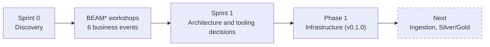

<table>
  <tr>
    <td align="center"><a href="docs/phase-00-discovery/BEAM_Workshop_Canvas.pdf">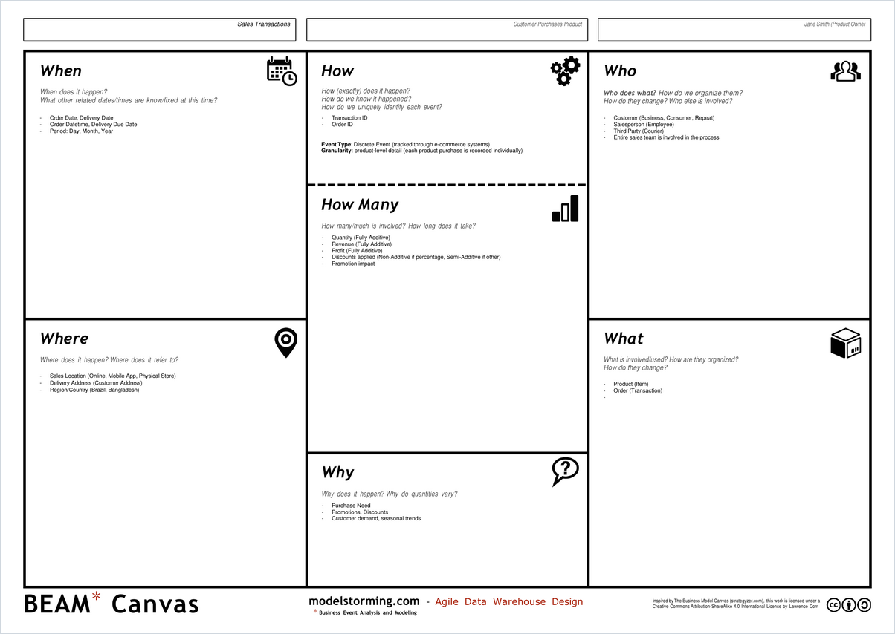</a><br><sub>BEAM* canvas: Sales Transactions</sub></td>
    <td align="center"><a href="docs/phase-00-discovery/Sprint0_Documentation.pdf">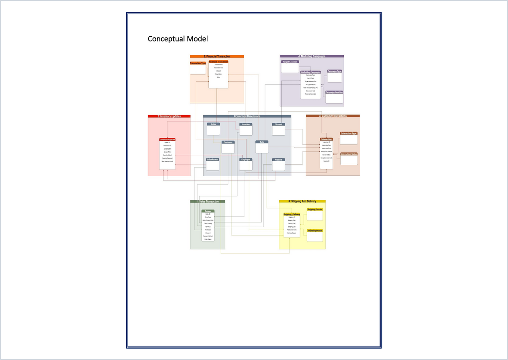</a><br><sub>Conceptual model with conformed dimensions</sub></td>
  </tr>
  <tr>
    <td align="center"><a href="docs/phase-00-discovery/Sprint0_Documentation.pdf">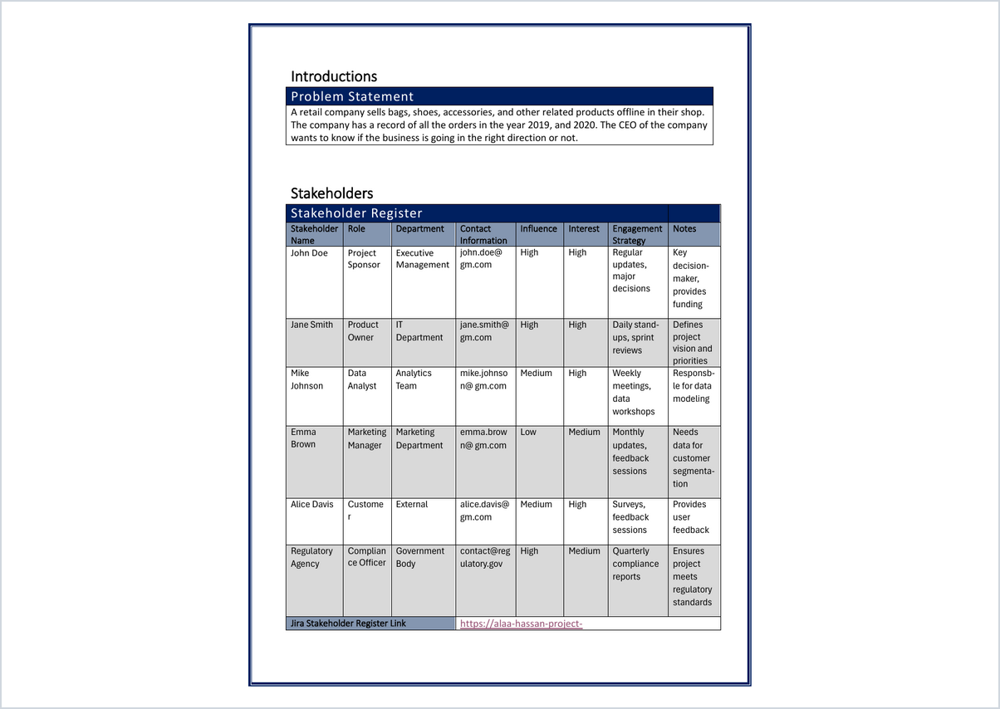</a><br><sub>Stakeholder register</sub></td>
    <td align="center"><a href="docs/phase-01-infrastructure/Sprint1_Documentation.pdf">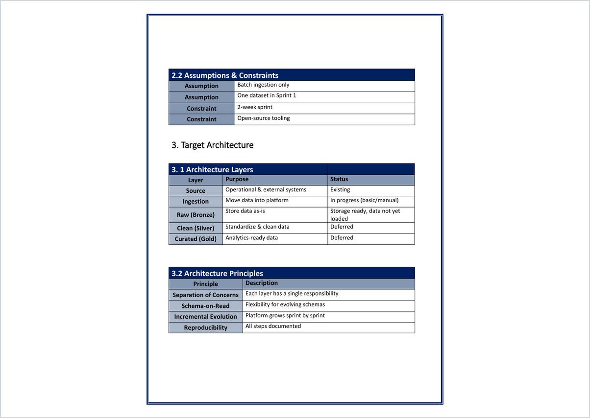</a><br><sub>Sprint 1: architecture layers</sub></td>
  </tr>
  <tr>
    <td colspan="2" align="center"><a href="docs/phase-00-discovery/Business_Events_Tables.xlsx">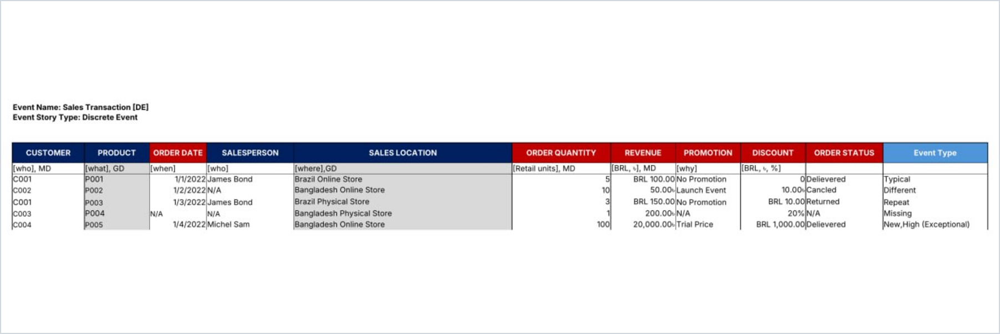</a><br><sub>Example data for the Sales Transaction event: tagged columns and edge cases (typical, different, repeat, missing, new/high)</sub></td>
  </tr>
  <tr>
    <td colspan="2" align="center"><a href="docs/phase-00-discovery/Business_Events_Tables.xlsx">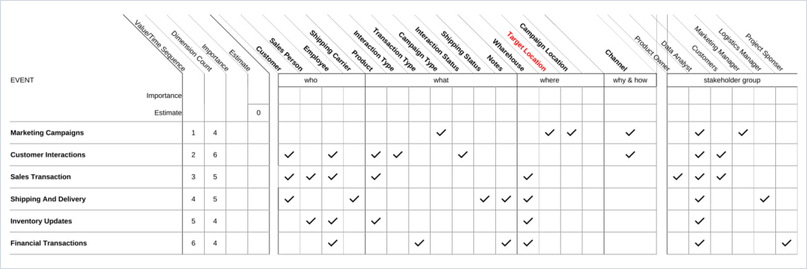</a><br><sub>Event-by-dimension matrix: shared dimensions across the six events</sub></td>
  </tr>
</table>

<sub>Click any preview to open the full document.</sub>

### Sprint 0: Discovery

- **Stakeholder register:** six stakeholders (sponsor, product owner, data analyst, marketing manager, customer, compliance officer) with influence/interest ratings and an engagement strategy for each.
- **Business events:** six events documented with the 7Ws (who, what, when, where, why, how, how many), event type, and fact granularity.
- **Conceptual model:** the six event fact tables connected through shared (conformed) dimensions: Date, Customer, Product, Location, Channel, Employee, and Salesperson.
- **Data source assessment:** nine datasets evaluated across the same five criteria:

| Criterion | What was assessed |
|---|---|
| Ingestion | Source type (SQL Server, MySQL, CSV, JSON, Python), frequency, batch vs near real-time |
| Data quality | Required quality level and the transformations each source needs |
| Storage | Initial volume and yearly growth (for example Brazilian e-commerce at roughly 333 MB, growing about 20% a year) |
| Processing | Batch vs real-time, and performance expectations |
| Reporting and security | User roles, access levels, and security requirements per source |

### BEAM\* workshop outputs

- **Six BEAM\* canvases**, one per business event, filled in by the standard canvas sections (When, How, Who, How Many, Where, What, Why). Each measure is classified as fully additive, semi-additive, or non-additive.
- **7Ws documentation sheets** with an initial data example for each event and its planned future use (for example predictive sales analysis, market basket analysis, customer sentiment analysis).
- **Example data tables** (one sheet per event) where every column is tagged as a who, what, when, where, why, or how-many element, with its unit (for example BRL/৳ or retail units). The sample rows deliberately include edge cases (typical, different, repeat, missing, and new/high-value) to expose data quality rules early.
- **Event-by-dimension matrix:** which dimensions each event uses, with counts per dimension. It shows where dimensions are shared across events (the conformed dimensions) and gives each event a priority sequence.

### Sprint 1: Architecture and tooling

- **Target architecture:** Source → Ingestion → Raw (Bronze) → Clean (Silver) → Curated (Gold), with an explicit status for each layer.
- **Architecture principles:** separation of concerns, schema-on-read, incremental evolution, and reproducibility.
- **Tooling decisions with trade-offs:** MinIO over a relational database and HDFS, Parquet as the file format, MySQL as the metastore backend, and Iceberg/Delta deliberately deferred.
- **Scope control:** clear in-scope and out-of-scope lists, a definition of done, and a risks, trade-offs, and deferred-items table.

## Documentation

| Document | Purpose |
|---|---|
| [Sprint 0: discovery](docs/phase-00-discovery/Sprint0_Documentation.pdf) | Stakeholders, business events, conceptual model, data source assessment |
| [BEAM* canvases](docs/phase-00-discovery/BEAM_Workshop_Canvas.pdf) | One canvas per business event |
| [Business events (7Ws)](docs/phase-00-discovery/Business_Events_Documentation.pdf) | 7Ws documentation for each event |
| [Event example tables](docs/phase-00-discovery/Business_Events_Tables.xlsx) | Example data per event with BEAM* dimension tags and edge cases, plus the event-by-dimension matrix |
| [Sprint 1: architecture](docs/phase-01-infrastructure/Sprint1_Documentation.pdf) | Target architecture, tooling decisions, definition of done |
| [Design document](docs/phase-01-infrastructure/DESIGN.md) | Scope, architecture, and rationale for Phase 1 |
| [Phase 1 overview](docs/phase-01-infrastructure/README.md) | What Phase 1 delivers and how it is validated |
| [Release notes v0.1.0](docs/phase-01-infrastructure/RELEASE_NOTES_v0.1.0.md) | Exact scope and outcomes of the release |

## What I Learned

Kubernetes StatefulSets, headless Services and stable DNS, PersistentVolumeClaims and pod-versus-data lifecycles, init containers, ConfigMap/Secret separation, building and layering custom Docker images, and writing safe, idempotent infrastructure scripts.
